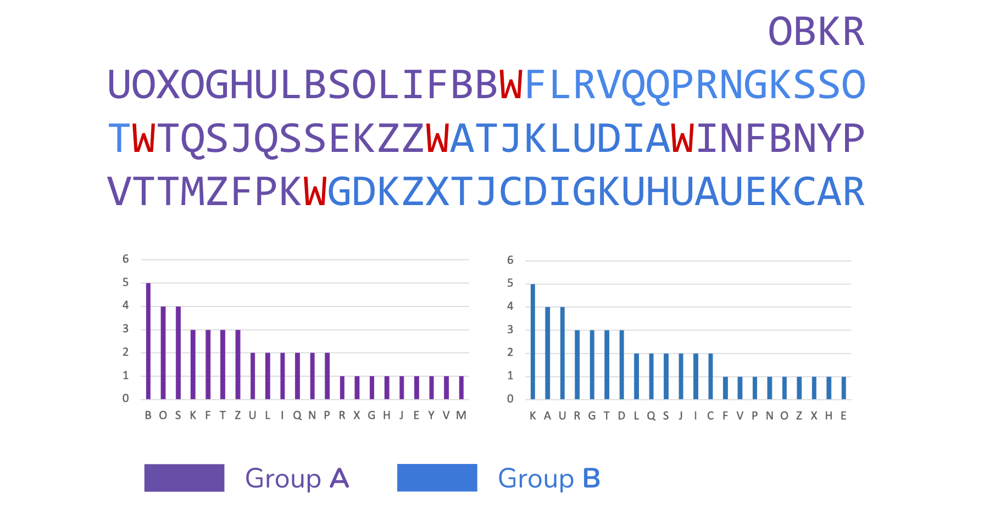

# K4nundrum

## About the Project

The [“Kryptos” sculpture](https://en.wikipedia.org/wiki/Kryptos), dedicated in 1990 by its creator Jim Sanborn, contains four encoded messages. Cryptography enthusiasts have successfully decoded three of them. However, the elusive fourth ciphertext, K4, remains undeciphered, presenting a fascinating challenge to the global community of cryptanalysts.

It remains one of the most famous unsolved codes.

The purpose of K4nundrum is to explore a hypothesis: what if K4 was a combination of several text segments combined with a letter not mapped to the plaintext?

K4nundrum uses letters as separators to split K4 into groups of text segments and assesses their similarities. Its main contribution is to have identified that, as far as K4 is concerned, the letter ‘W’ could act as a separator that generates two groups with the same letter frequency distribution shapes (assigned to different letters).



These findings are detailed in this blog post: *[A Fresh Perspective on Kryptos K4, the Decades-Old Unsolved Code](https://guyomel.hashnode.dev/a-fresh-perspective-on-kryptos-k4)*.

The split of K4 on the letter W was already described in April 2016 on Puzzling Stack Exchange, in an [answer by "Bobson"](https://puzzling.stackexchange.com/questions/25931/unsolved-mysteries-kryptos/30772#30772) crediting "void solid" and "dankuda" of the Kryptos Yahoo group.

Contributions are welcomed (`CONTRIBUTING.md`).

## Usage

### Analyze K4

Assuming that Go is installed on your system (if not: [how to install Go](https://go.dev/doc/install)), run:

```
$ go run ./...
```

This command analyzes the original K4.

Expected output:

```
> OBKRUOXOGHULBSOLIFBBWFLRVQQPRNGKSSOTWTQSJQSSEKZZWATJKLUDIAWINFBNYPVTTMZFPKWGDKZXTJCDIGKUHUAUEKCAR
  Separator: W

  Group 1:	INFBNYPVTTMZFPK OBKRUOXOGHULBSOLIFBB TQSJQSSEKZZ 
  Letter Freq.:	B:5  S:4  O:4  T:3  K:3  Z:3  F:3  U:2  I:2  Q:2  L:2  N:2  P:2  H:1  J:1  V:1  M:1  X:1  Y:1  R:1  G:1  E:1  

  Group 2:	ATJKLUDIA FLRVQQPRNGKSSOT GDKZXTJCDIGKUHUAUEKCAR 
  Letter Freq.:	K:5  U:4  A:4  R:3  D:3  T:3  G:3  C:2  S:2  Q:2  J:2  I:2  L:2  H:1  V:1  Z:1  F:1  E:1  O:1  X:1  P:1  N:1

  Rectangle:	rows of 19 (5 rows): W at (2,2) (2,18) (4,2) (4,18); center mark at (3,11)

Analysis Completed.
Same shapes:	1
K4-like:	1
K4-like+rect.:	1
```

The order of letters with the same frequency may vary from one run to another.

### The W-Rectangle Hypothesis

K4 has 97 letters and five of them are W. Written in rows of 19 letters, K4 fills five complete rows and leaves two letters (`AR`). In this grid, four of the five W's stand on mirror-symmetric cells: one cell in from each of the four corners (rows 2 and 4, columns 2 and 18). The fifth W stands one cell right of the center of the grid (row 3, column 11). K4nundrum describes this pattern; it makes no claim about whether it is deliberate.

```
 1  O B K R U O X O G H U L B S O L I F B
 2  B W F L R V Q Q P R N G K S S O T W T
 3  Q S J Q S S E K Z Z W A T J K L U D I
 4  A W I N F B N Y P V T T M Z F P K W G
 5  D K Z X T J C D I G K U H U A U E K C
    A R
```

A "symmetric rectangle" is a set of four occurrences of a letter that stand on the four mirror images of one cell (left-right and top-bottom) in the grid obtained by writing the text in rows of a given width (3 to 48 letters, at least 2 complete rows; the middle row and column cannot be part of one). K4 has a symmetric rectangle for the letter W only, and at one width only (19).

#### Find the Rectangles

```
$ go run ./... --rectangle
```

This prints, for the analyzed ciphertext (K4 by default, or the one given with `--ciphertext`), every letter that forms at least one symmetric rectangle, then exits:

```
> OBKRUOXOGHULBSOLIFBBWFLRVQQPRNGKSSOTWTQSJQSSEKZZWATJKLUDIAWINFBNYPVTTMZFPKWGDKZXTJCDIGKUHUAUEKCAR
  Separator: W

  Rectangle:	rows of 19 (5 rows): W at (2,2) (2,18) (4,2) (4,18); center mark at (3,11)

```

The regular analysis also prints the rectangles of a separator after its groups.

#### Exact Statistics

```
$ go run ./... --rectangle-stats
```

This counts every possible placement of five separators among the letters of the analyzed text (97 for K4; texts longer than 160 letters are refused) and compares the counts with the pattern of K4. The percentages are exact counts over all placements, not estimates:

```
Exact statistics: 5 separators placed at random among 97 positions

                                                        placements        share        1 in
All placements                                          64,446,024
Alternating groups of equal size (2024 pattern)          1,272,384      1.9743%          51
  with no doublet and segments of 3+ letters               549,081      0.8520%         117
W rectangle (outer separators on mirror cells)              26,734      0.0415%       2,411
  with the middle separator next to the grid center          1,754      0.0027%      36,742
  with corners one cell in from the grid's corners             775      0.0012%      83,156
2024 pattern and W rectangle together                          650      0.0010%      99,148
W rectangle among placements with the 2024 pattern 650 / 1,272,384      0.0511%       1,958
  with no doublet and segments of 3+ letters         347 / 549,081      0.0632%       1,582

K4, separator W (positions 21, 37, 49, 59, 75): 2024 pattern yes; W rectangle yes, rows of 19; center mark yes; inset corners yes
```

Here, the rectangle is formed by the four outer separators (the 1st, 2nd, 4th and 5th); the middle one is the candidate center mark. The last two lines are conditional: among the placements that already show the 2024 pattern, about 1 in 1,958 also forms a rectangle (1 in 1,582 when segments shorter than 3 letters are excluded, as K4nundrum does for K4-like groups).

#### Simulating the Rectangle

```
$ go run ./... --sim --rectangle
```

This is a fast simulation: pseudo-K4s are generated and only the rectangle metrics are recorded (the groups analysis is skipped). The simulation counts random 97-letter strings, in which any of the 26 letters can form a rectangle. The following metrics are added to `stats.txt` (they are also recorded by `--sim`, once per pseudo-K4):

* `Symmetric rectangle`: at least one letter forms a symmetric rectangle (any width),
* `Rectangle, 5+ rows`: at least one rectangle has 5 rows or more,
* `Rectangle + center`: at least one rectangle has a center mark,
* `Rectangle, inset`: at least one rectangle has a center mark and corners one cell in from the corners of the grid (the shape observed in K4),
* `K4-like + rectangle`: K4-like groups whose separator also forms a symmetric rectangle (only available with `--sim` without `--rectangle`).

Sample `stats.txt` from a run of about 75 seconds that covered 1,595,307 pseudo-K4s:

```
Same distribution shapes 	0.00%	         0/1595307
Groups length > 2        	0.00%	         0/1595307
Alternating groups       	0.00%	         0/1595307
K4-like groups           	0.00%	         0/1595307
Symmetric rectangle      	4.6095%	     73535/1595307
Rectangle, 5+ rows       	1.8676%	     29794/1595307
Rectangle + center       	0.3733%	      5955/1595307
Rectangle, inset         	0.0114%	       182/1595307
K4-like + rectangle      	0.0000%	         0/1595307
```

(The first four lines are zero because the groups analysis is skipped in this mode.)

### Run a Simulation

For statistical purposes, K4nundrum can also process random strings consisting of 97 uppercase letters (“pseudo-K4s”).

```
$ go run ./... --sim
```

When this mode is enabled, a file named `stats.txt`, generated in its root directory, is regularly updated. It keeps track of the following metrics:

* `Same distribution shapes`: identical letter frequency distribution shapes,
* `Groups length > 2`: appropriately sized group sizes (excluding groups with 1 or 2 characters),
* `Alternating groups`: groups that are alternating in the pseudo-K4s (example: `A|B|C|A|B|C|A|B|C`),
* `K4-like groups`: groups having all of the above characteristics, corresponding to K4-like groups (strings characterized by a pattern observed with K4),
* `Symmetric rectangle`, `Rectangle, 5+ rows`, `Rectangle + center`, `Rectangle, inset` and `K4-like + rectangle`: the rectangle metrics (see [The W-Rectangle Hypothesis](#the-w-rectangle-hypothesis)).

The analyses run in parallel. The number of parallel workers (set to 20 by default) can be defined using the `--workers {{number}}` option.

`^C` terminates the simulation.

#### Statistics on the Generation of ~1 Million Pseudo-K4s

Here are some statistics from a simulation that generated and analyzed about 1 million pseudo-K4s in March 2024:

```
Same distribution shapes  1.74%	     17961/1031972
Groups length > 2         0.57%	      5923/1031972
Alternating groups        0.07%	       671/1031972
K4-like groups            0.04%	       458/1031972
```

### Analyze Custom Ciphertexts

K4nundrum can also analyze arbitrary ciphertexts, provided that they do not contain non-alphabetic characters:

```
$ go run ./... --ciphertext {{ciphertext}}
```
Example:

```
$ go run ./... --ciphertext QSWGVHEMUVHMGXLGRYYZRXCQLVXUVFGBELXRGYMESPXFNVQNYVPRK
```
